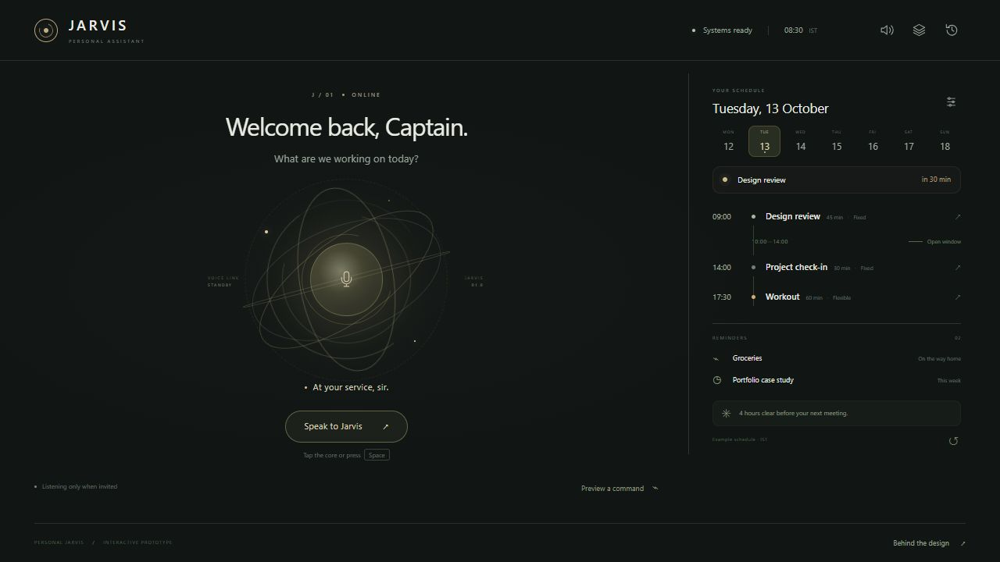

# Personal Jarvis

A voice-controlled personal assistant concept by **Sannith Vanamala**, focused on daily planning and actions across your personal workspace.

**Status: interactive design prototype.** This repository captures the current design and interaction foundation for the actual assistant to be built next.



## The idea

Jarvis should feel like a personal presence: a central voice core, a consistent assistant persona, and useful context at the edge of the screen. The visual direction takes inspiration from the composure and responsiveness of Iron Man's assistant, interpreted through restrained colors and a clean contemporary interface.

Spoken requests are the primary input. A compact schedule shows upcoming events, reminders, and concise insights. Plans become visible when they need review, with approval before changes and a clear way to undo them.

## Run locally

The prototype is plain HTML, CSS, and JavaScript. No dependencies or build step are required.

From the repository root, run:

```sh
python -m http.server 8000 --directory dist
```

Open `http://localhost:8000` for the assistant, or `http://localhost:8000/case-study.html` for the design case study.

## Try the interaction

- Tap the voice core or press **Space** to speak. A completed utterance is submitted automatically.
- Say **proceed**, **later**, **earlier**, **cancel**, or **undo** to control a proposed plan.
- Press **Escape** to stop listening or speaking.
- Use **Preview a command** for the three sample scenarios without a microphone.
- Review individual proposed actions, adjust their time, approve selected changes, and inspect the action receipt.
- Open **Memory** to inspect, pause, edit, add, or forget preferences. Open **Activity** to review or undo previous actions.

Voice recognition and synthesis use the browser's Web Speech APIs. Availability depends on the browser and microphone permissions. Live microphone and mobile device validation remain part of the next iteration.

## What is implemented

- Voice-centered interface with listening, planning, speaking, and approval states.
- Three deterministic planning scenarios using example calendar and task data.
- Selective approval, time corrections, completion receipts, and undo.
- Context, memory, and activity panels with local browser persistence.
- A visual case study documenting the problem, design decisions, interface revision, and proposed usability validation.

## Prototype boundaries

Calendar events, tasks, reminders, and alerts are sample data. Actions change only the local demonstration workspace. No conversational model, calendar account, task service, or production audio service is connected.

Custom memory text is stored for the future build; only the preset preference flags currently affect planning. The case study describes a proposed study and does not claim completed participant research.

## Next build

1. Define and test the first real daily-planning journey, including voice and mobile use.
2. Introduce a conversational model and streaming audio with reliable interruption handling.
3. Connect calendar and task services with explicit permissions and review before writes.
4. Add conflict handling, partial-failure recovery, and action history that reflects real service state.
5. Make personal memory useful, inspectable, and removable across sessions.

These are future directions, not capabilities of this prototype.

## Source structure

```text
dist/
  index.html          Assistant interface
  app.js              Voice input, planning, review, memory, and activity
  style.css           Assistant layout, visual states, and motion
  case-study.html     Product design case study
  case-study.css      Case study presentation
  assets/             Screenshots used in the case study
```

## Authorship

Product direction and iteration by Sannith Vanamala. Developed with AI assistance in design and implementation.
