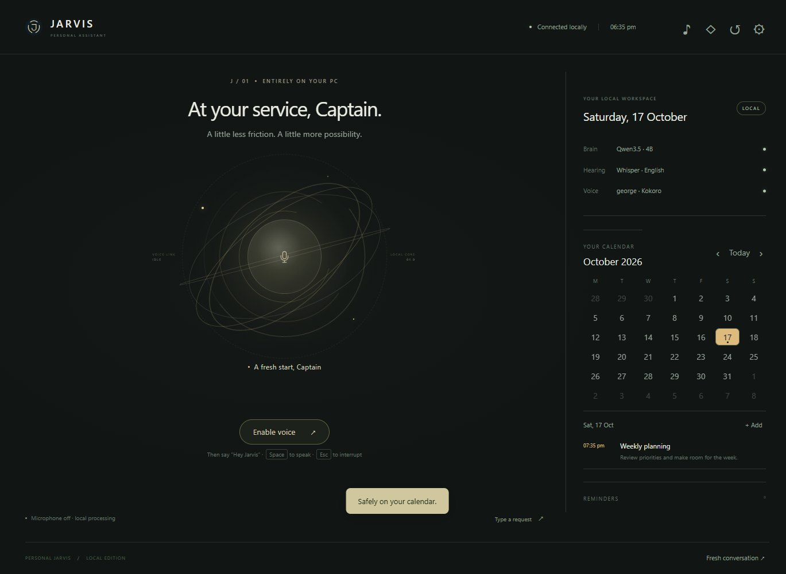

# Personal Jarvis

A local, voice-first Windows assistant by Sannith Vanamala. Talk naturally, manage your calendar, work with files and apps, and keep your conversations on your own PC.

**Windows 10/11 x64 · No API key · Choose your local model · No Jarvis background processes after closing**

## Install

1. Download the **[latest Windows package](https://github.com/Saneitt/personal-jarvis/releases/latest)**. You can also use GitHub's **Code → Download ZIP**.
2. Extract the complete folder to a permanent location outside OneDrive, such as **C:\Apps\PersonalJarvis**. Run setup after moving it.
3. Double-click **Setup Jarvis.cmd**. It detects RAM and NVIDIA VRAM, offers a model menu, and downloads the selected brain, speech models and self-contained Python/Ollama runtimes. The initial download needs internet and several GB of free space.
4. Search **Jarvis** in the Windows Start menu and open it. **Launch Jarvis.cmd** works too.
5. Click **Enable voice**. Say **“Hey Jarvis”**, pause for the acknowledgement, then speak. Follow-ups stay open for 40 seconds without repeating the wake phrase.

Setup is resumable. There is no separate Python, Node, Git, Docker, paid account or system Ollama installation required. Microsoft WebView2 and .NET Framework 4.8 host the Windows window; setup checks the runtime and builds the launcher.

**Close the window to stop Jarvis.** Its backend, private Ollama instance, model runner and microphone stop with it. Minimized windows remain active. Nothing starts automatically at Windows login. **Stop Jarvis.cmd** provides a second way to close the app and stop its services.

## Choose a brain

Setup downloads only your chosen model. These are practical starting points, not guaranteed memory fits or intelligence benchmarks.

| Choice | Suggested hardware | Approximate source download | Use |
| --- | --- | --- | --- |
| Qwen3.5 0.8B | 8 GB RAM, CPU | 1.2 GB | Basic conversation on limited hardware; weaker tool use |
| Qwen3.5 2B | 8–16 GB RAM, CPU or entry-level GPU | 2.7 GB | Lighter entry point |
| **Qwen3.5 4B** | **16 GB RAM, 4 GB NVIDIA VRAM** | **3.3 GB** | **Tested default on the development laptop** |
| Qwen3.5 9B | 24 GB RAM, 8–12 GB VRAM | 6.6 GB | More capacity for stronger PCs |
| Qwen3.5 27B | 48 GB RAM, 24 GB VRAM | 17 GB | High-memory desktop |
| Qwen3.5 35B MoE | 64 GB RAM, 32 GB VRAM | 22 GB | Workstation; test conversational latency |

Only the 4B setup has been exercised on the development laptop. Larger choices are upgrade candidates; context cache, speech and other programs require memory too. CPU-only inference is supported by Ollama and can be substantially slower. GPU support depends on Ollama and your drivers. Source sizes and available variants can change: [official model library](https://ollama.com/library/qwen3.5).

The Qwen profiles reuse the language weights and native tool parser without the unused vision projector. Speech, tools, calendar and explicit memory remain independent of the brain.

Choose **Settings → Local brain** to switch installed models. To install another later, rerun Setup Jarvis and choose it, or use the download script while Jarvis is open:

~~~powershell
.\.venv\Scripts\python.exe scripts\pull_model.py qwen3.5:9b
~~~

Another local Ollama model can be entered during setup. It must support tool calls and a compatible non-thinking mode. Other model families need their own compatibility check.

## Voice and calendar

- The central core or **Space** opens listening immediately. **Escape** stops a reply.
- Speak naturally to interrupt. Choose **Speakers** or **Headphones** in Settings.
- **Turn microphone off** stops capture. Closing the window also stops it.
- **Settings → Test voice** previews George, Fable, Lewis, Daniel or lightweight Piper/Alan at your chosen speed. Listening pauses for the sample.
- The right column has a month calendar and selected-day agenda. Click **+ Add** for an event or reminder, and click an agenda entry to edit, reschedule or remove it.
- Events support notes, all-day dates and optional advance alerts. Voice can read and change the same local calendar.
- Alerts sound while Jarvis is open. Closing or sleeping the PC prevents timely alerts; pending reminders remain saved and are delivered when the app next runs. Calendar alerts for events already ended are skipped.

Try “How is my computer doing?”, “Open Notepad”, “What is on my calendar tomorrow?”, “Add a meeting tomorrow at ten for half an hour”, or “Remind me to stretch in twenty minutes.”

The manner is calm and respectful, with occasional dry humour. The interface keeps voice at the centre, with a single response caption and a secondary typed fallback.

## What it can do

- Offline English wake-word detection and transcription with openWakeWord and faster-whisper.
- Local Kokoro speech, with Piper as a lighter alternative.
- Streaming conversation and structured tool calls through Ollama.
- File browsing, filename search, text reading/writing, folder creation, moves and Recycle Bin deletion under your Windows account.
- Open apps, files, folders and websites; inspect system status; control volume/media; read the clipboard.
- Run PowerShell for operations beyond the built-in tools.
- Save explicit preferences, calendar events and reminders in SQLite.
- Show actual tool results and failures in Activity.

File overwrites, moves, deletes, unknown executables and PowerShell request confirmation. Say “proceed” or use the visible control. Approvals expire after two minutes; overwrites retain backups. Settings can disable PowerShell confirmation. Cancelling an action cannot undo a change already completed.

## Scope

This is a working personal assistant, not a replacement for every Windows application. Its access is your normal account's access. It has no external Google/Outlook calendar sync, connected email, live web search, autonomous screen-driven GUI control or background tray listener.

English is the configured speech language. Recognition depends on your accent, room, microphone and noise. A small model can misunderstand requests or choose the wrong arguments. Wider usability validation and other hardware profiles remain future work.

Text file reading is bounded to 16 KB; filename searches are bounded to eight seconds and 40 matches. Binary document formats need an appropriate application or extra integration.

The default Hey Jarvis wake model has a separate noncommercial license. Application source is MIT; models and dependencies retain their own licenses. See [third-party notices](docs/THIRD_PARTY.md) before commercial use or redistribution.

## Your data and updates

All model, speech and tool processing runs on this PC. Setup downloads need internet; opening a website uses the internet normally. No cloud speech API or API key is used.

- **data/**: SQLite records, overwrite backups and service diagnostics
- **models/**: downloaded brain and speech weights
- **config.local.json**: saved preferences and runtime settings
- **.runtime/** and **.venv/**: self-contained runtime and native window

Raw microphone audio stays in memory. Conversation turns stay in memory for the current window. Explicit memories, tool arguments/results, events and reminders persist locally.

The app binds to localhost:8765 and private Ollama to localhost:11435. API requests use a per-run token with origin checks. This protects the app's entry points from arbitrary websites; it is not isolation from other local programs.

To update, close Jarvis, keep data/, models/ and config.local.json, replace the source files, and rerun Setup Jarvis. To move computers, copy those data folders and settings, then run setup on the new PC. Recreate .venv rather than copying absolute interpreter paths. Run setup again after moving the installation so the Start menu link points to the new location.

## Development

~~~powershell
.\.venv\Scripts\python.exe -m pytest tests -q
node --test tests/audio-player.test.cjs
.\.venv\Scripts\python.exe scripts\verify_speech.py
.\.venv\Scripts\python.exe scripts\package_release.py --with-desktop
~~~

launch.ps1 -NoWindow is a development-only service mode; stop it explicitly with stop.ps1. Normal launch always uses the native window and owns service shutdown.

Windows CI runs core tests, builds the native window and packages a clean ZIP. The package excludes personal data, installed models, runtime caches and local settings. Release artifacts include a SHA-256 checksum. Models are downloaded from their upstream sources during setup.

See [architecture](docs/ARCHITECTURE.md), [model measurements](docs/MODELS.md) and [build verification](docs/BUILD_STATUS.md). Automated audio checks use generated fixtures; they do not replace listening checks with real users. The developer has confirmed that the standalone voice and updated conversation playback sound smooth on the development laptop.

## Credits

Product direction, design and project: **Sannith Vanamala**. Developed with AI assistance. Third-party projects and model licenses are listed in docs/THIRD_PARTY.md.
